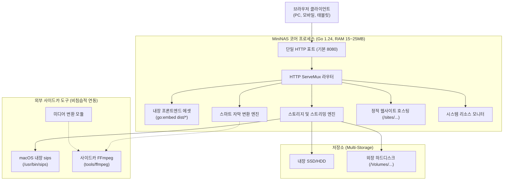

# MiniNAS 시스템 요구사항 및 기술 규격서 (SPEC.md)

> **문서 버전**: v0.1.0  
> **최초 작성일**: 2026-11-07  
> **목적**: 2011 Mac mini 등 구형 인텔 맥 하드웨어를 활용한 초경량 독립형 홈 NAS 애플리케이션의 아키텍처 원칙, 기능별 요구사항, API 규격, 제약 조건을 정의합니다. 본 문서는 새로운 기능이 추가되거나 아키텍처가 변경될 때마다 지속적으로 갱신됩니다.

---

## 1. 하드웨어 목표 및 제약 조건 (Target Constraints)

| 항목 | 규격 및 제약 조건 |
| :--- | :--- |
| **대상 기기** | 2011 Mac mini (Intel Core i5 Sandy Bridge, x86_64) |
| **운영체제** | macOS High Sierra (10.13.6) |
| **운영 형태** | 모니터/키보드가 연결되지 않은 무인 헤드리스(Headless) 24시간 가동 |
| **가용 리소스 제한** | 상시 메모리(RAM) 점유율 **30MB 미만**, 유휴 시 CPU 점유율 **1% 미만** |
| **런타임 제약** | **Docker 미사용**, 외부 런타임(Python, Node.js, Java, .NET 등) 설치 요구 금지 |
| **배포 단위** | 프론트엔드가 자체 내장된 **단일 정적 바이너리(Single Binary, Pure Go, CGO_ENABLED=0)** |

---

## 2. 핵심 아키텍처 원칙 (Core Architectural Principles)

1. **단일 포트 단일 바이너리 (Monolithic Single Binary)**:
   - 프론트엔드(React + TypeScript + Tailwind) 빌드 산출물을 Go의 `//go:embed`로 백엔드 바이너리에 직접 번들링.
   - 단 하나의 포트(기본 8080)에서 웹 UI, REST API, 스트리밍, 정적 사이트 호스팅을 모두 처리.
2. **사이드카 분리 패턴 (Sidecar Separation Pattern)**:
   - 코어 바이너리는 7MB 순수 Go로 가볍게 유지.
   - 무거운 미디어 트랜스코딩 엔진(FFmpeg 등)은 코어에 내장하지 않고 독립 실행 파일(`tools/ffmpeg`)로 분리하여 필요할 때만 비동기 자식 프로세스로 호출.
3. **무결점 레거시 호환성 (macOS 10.13 Target)**:
   - macOS 12+ 전용 보안 심볼(`_SecTrustCopyCertificateChain` 등) 링크를 원천 차단하기 위해 `CGO_ENABLED=0`, `MACOSX_DEPLOYMENT_TARGET=10.13`으로 정적 빌드.
4. **제로 버퍼 스트리밍 I/O (Zero-Buffer Streaming)**:
   - 파일 업로드 및 다운로드 시 메모리에 전체 데이터를 적재하지 않고 디스크와 네트워크 소켓 간 직접 스트리밍(`io.Copy`).
   - 다중 파일/폴더 다운로드는 메모리 임시 압축 파일 생성 없이 `archive/zip` 실시간 스트림으로 전송.

---

## 3. 세부 기능 규격서 (Functional Specifications)

### 3.1 스토리지 엔진 (Storage Engine)
- **멀티 저장소(Multi-Storage)**:
  - 설정 파일(`config.json`)에 정의된 다수의 저장소 경로(내장 경로, 외장 하드 `/Volumes/...`)를 독립적인 논리 스토리지로 마운트.
  - `$HOME` 환경 변수 자동 확장 지원.
  - 각 스토리지별 전체 용량, 사용량, 가용 공간 실시간 조회 (`statfs` 시스템 콜).
- **보안 샌드박스 (Directory Traversal Protection)**:
  - 모든 파일 API 요청 경로는 `filepath.Clean` 및 절대 경로 검증을 거쳐 설정된 저장소 루트를 벗어나는 상위 경로 탈출(`../`)을 원천 차단 (`403 Forbidden`).
- **파일 조작 API**:
  - 디렉토리 생성(`POST /api/files/mkdir`), 이름 변경(`POST /api/files/rename`), 단일 및 일괄 다중 파일 삭제(`POST /api/files/delete`).
  - 파일 복사(`POST /api/files/copy`) 및 파일 이동(`POST /api/files/move`): 동일 스토리지 내 원자적 이동 및 크로스 스토리지 복사/이동, 중복 시 자동 고유명 부여 (`(1)`).
  - 대용량 파일 청크 스트리밍 업로드 (`multipart/form-data`).
  - 다중 파일/폴더 실시간 ZIP 압축 다운로드 (`GET /api/files/download-zip`).

---

### 3.2 웹 파일 탐색기 & 파일 관리 UI (Web Explorer & File Management)
- **뷰 모드 전환**: 그리드 뷰(그리드 아이콘), 리스트 뷰(상세 메타데이터), **넷플릭스 시네마 뷰(동영상 전용)** 원클릭 전환 지원.
- **동영상 폴더 지능형 감지 (Netflix Mode Auto-Detection)**:
  - 현재 폴더에 비디오 파일이 포함되어 있을 경우 상단 알림 배너 및 헤더 넷플릭스 뷰 토글 뱃지 자동 점등.
  - 클릭 한 번으로 OTT(넷플릭스) 시네마 모드로 즉각 전환.
- **넷플릭스 스타일 시네마 UI (Netflix View)**:
  - **대형 히어로 빌보드 (Featured Billboard)**: 폴더 내 대표/첫 번째 동영상의 대형 프리뷰, 타이틀, 화질/포맷 뱃지, 즉시 재생/상세정보/다운로드 버튼 제공.
  - **넷플릭스 스타일 비디오 카드 그리드**: 16:9 비율 썸네일 자동 캡처 프리뷰, 호버 시 줌/확대 애니메이션 (`scale-105`), 에피소드(EP) 번호 파싱, 카드 내 퀵 재생/다운로드/관리 메뉴.
  - **시리즈 & 하위 폴더 섹션**: 하위 폴더가 있을 경우 넷플릭스 컬렉션/시즌 카드 형태로 분리 렌더링.
  - **자막 및 부가 파일 섹션**: 비디오 외 자막/문서 파일도 일목요연하게 표시하여 누락 방지.
- **파일 관리 기본 기능 (File Operations)**:
  - **복사 & 이동 (Cut / Copy / Paste)**: 다중 선택 또는 단일 항목 복사(`Cmd/Ctrl+C`), 잘라내기(`Cmd/Ctrl+X`), 원하는 폴더에서 붙여넣기(`Cmd/Ctrl+V`).
  - **정렬 (Multi-Field Sorting)**: 이름순, 수정일자순, 파일 크기순, 파일 형식순 정렬 및 오름차순/내림차순 토글. (폴더 우선 정렬 지원)
  - **우클릭 컨텍스트 메뉴 (Context Menu)**: 파일/폴더 우클릭 시 열기, 다운로드, 복사, 잘라내기, 이름 변경, 상세 정보, 삭제 메뉴 제공. 빈 공간 우클릭 시 새 폴더, 업로드, 붙여넣기, 새로고침 제공.
  - **파일 상세 정보 모달 (File Properties)**: 파일명, 스토리지, 형식, 용량(바이트 단위 상세), 수정일시, 전체 경로 확인.
  - **단일 및 다중 삭제**: 각 항목별 빠른 삭제 버튼 및 확인 다이얼로그로 안전한 파일 삭제.
- **반응형 Finder 스타일**: 좌측 저장소/필터 사이드바 + 상단 경로 네비게이션(Breadcrumbs) + 메인 파일 뷰어.
- **스마트 파일명 중간 생략 (`truncateMiddle`)**:
  - 긴 릴리즈 파일명(예: `[Release-Group] Title - 01 [1080p x264 EAC3][Hash]_web.mp4`) 처리 시:
  - 작품명 앞부분과 회차 번호(`- 01`, `EP01`), 웹 변환 태그(`_web`), 확장자(`.mp4`, `.ko.srt`)를 보존하고 중간 불필요 해시만 `...`으로 축약.
  - 마우스 호버 시 브라우저 네이티브 툴팁으로 전체 원본 파일명 표시.
- **HTML5 History API 네이티브 네비게이션**:
  - 폴더 이동 시 URL 쿼리 파라미터(`?storage=...&path=...&view=...`) 실시간 갱신 및 히스토리 스택 적재.
  - 브라우저 '뒤로 가기/앞으로 가기' 및 마우스/트랙패드 제스처 시 NAS 밖으로 이탈하지 않고 직전 폴더로 단계별 이동.
  - 미디어 재생 창이 열려 있을 때 '뒤로 가기' 입력 시 동영상 모달만 닫히며 원래 폴더 유지.
  - 브라우저 새로고침(F5) 시 현재 탐색 중인 폴더 및 스토리지 유지.

---

### 3.3 미디어 플레이어 & 자막 서브시스템 (Media & Subtitles)
- **HTTP 206 Partial Content 스트리밍**:
  - 대용량 비디오(MP4, MKV 등) 재생 시 Range 헤더를 지원하여 임의 구간 즉시 탐색(Seek) 지원.
- **스마트 자막 자동 감지 & WebVTT 실시간 변환**:
  - 영상 파일명과 매칭되는 동일 디렉토리 내의 외부 자막(`.srt`, `.smi`, `.vtt`) 자동 매칭.
  - `_web.mp4`로 변환된 파일도 원본 기준 자막(`.ko.srt`) 자동 연동.
  - 자막 텍스트 인코딩(UTF-8, EUC-KR, CP949)을 자동 감지하여 깨짐 없는 UTF-8 WebVTT로 온더플라이 변환 스트리밍.
- **ASS 특수 태그 지능형 정제 (`cleanSubtitleText`)**:
  - ASS 자막의 화면 상단 정렬 태그(`{\an8}`)를 브라우저 표준 WebVTT 큐 속성(`line:8%`)으로 자동 변환.
  - `{\pos(x,y)}`, `{\c&H...&}`, `{\b1}` 등 모든 ASS 중괄호 스타일 코드 및 비표준 `` 태그를 텍스트에서 완전 제거.
- **복수 한국어 자막 & 다국어 UI 바**:
  - 외장 자막(`.ko.srt`)과 컨테이너 내장 한국어 자막이 모두 존재하는 경우:
  - `[🇰🇷 한국어 (외장)]`, `[🇰🇷 한국어 (내장)]` 버튼을 각각 노출하여 사용자가 원하는 트랙을 즉시 전환 선택 가능.
  - 영어(`[🇺🇸 English]`), 일본어(`[🇯🇵 日本語]`) 퀵 버튼 및 최대 30개 다국어 자막 드롭다운(`🌐 기타 언어...`) 제공.
  - `video.textTracks` 모드를 제어하여 선택한 자막만 즉각 동기화 렌더링.

---

### 3.4 사이드카 미디어 변환기 (Sidecar Media Converter)
- **웹 호환성 자동 진단 (`/api/media/inspect`)**:
  - 비디오 코덱(H.264, VP8, VP9, AV1 지원 여부).
  - 오디오 코덱(AAC, MP3, Opus 지원 여부 / EAC3, AC3, DTS 등 브라우저 미지원 코덱 감지).
  - 내장 자막 트랙 목록 및 한국어 자막 포함 여부.
  - 외부 한국어 자막 부재 여부.
- **초고속 스트림 복사 & AAC 변환 (`/api/media/batch-convert`)**:
  - 영상은 무손실 초고속 스트림 복사 (`-c:v copy`).
  - 오디오만 브라우저 표준 AAC 192k로 변환 (`-c:a aac -b:a 192k`).
  - 내장된 한국어 자막 스트림을 별도 `.ko.srt` 파일로 자동 추출.
  - 단일 파일 변환 및 폴더 전체 일괄 배치 변환(백그라운드 Goroutine, 진행률 폴링 API) 지원.
  - 원본 대체 옵션 또는 `_web.mp4` 신규 생성 옵션 제공.
  - 변환이 불필요하거나 이미 완료된 `_web.mp4` 영상에서는 상단 변환 버튼 자동 숨김.

---

### 3.5 아이폰 사진 & 이미지 뷰어 (HEIC Processing)
- **`sips` 기반 실시간 무손실 변환**:
  - 웹 브라우저가 직접 지원하지 않는 아이폰 사진(`.heic`) 요청 시 macOS 내장 `/usr/bin/sips`를 호출하여 고화질 JPEG로 즉석 변환.
  - 변환된 썸네일/이미지는 `~/.mininas_cache/thumbs/` 디렉토리에 캐싱하여 중복 변환 방지.

---

### 3.6 정적 웹사이트 & HTML 호스팅 (`/sites/...`)
- **실시간 정적 웹 호스팅**:
  - 스토리지 내의 모든 웹 프로젝트 디렉토리를 별도 서버(Nginx/Apache) 없이 독립 웹사이트로 서비스.
  - 엔드포인트: `/sites/<storage_id>/<path>` (단일/기본 저장소는 `/sites/<path>`).
  - `index.html` 파일 및 상대 경로 리소스(CSS, JavaScript, 이미지, 웹폰트) 완벽 서빙.
  - `index.html`이 없는 디렉토리 접근 시 파일 목록을 보여주는 모던 디렉토리 인덱싱(Directory Indexing) 렌더링.
  - 파일 탐색기에서 `.html` 파일 선택 시 `[🌐 웹페이지로 열기]` 바로가기 버튼 제공.

---

### 3.7 시스템 운영 및 진단 (DevOps & Daemon)
- **macOS `launchd` 서비스 데몬화**:
  - `com.mininas.server.plist`를 통한 부팅 시 자동 실행(RunAtLoad) 및 비정상 종료 시 자동 복구(KeepAlive).
- **설정 사전 진단기 (Pre-flight Checker)**:
  - `mininas -config <file> -check` 플래그를 통해 서비스 가동 전 JSON 문법 및 마운트 디렉토리 유효성 사전 검사.
  - 설정에 오류가 있을 경우 기존에 정상 구동 중인 데몬을 중단하지 않고 보호.
- **원클릭 제어 스크립트 번들**:
  - `start-nas.command`: 데몬 등록 및 백그라운드 가동
  - `stop-nas.command`: 데몬 중지
  - `restart-nas.command`: 사전 진단 후 안전 재시작
  - `check-config.command`: 설정 파일 문법/경로 검사
  - `convert-folder.command`: 터미널 미디어 일괄 변환 도구

---

## 4. REST API 규격 요약

| Method | Endpoint | 설명 | 파라미터 / 페이로드 |
| :--- | :--- | :--- | :--- |
| `GET` | `/api/storages` | 등록된 스토리지 목록 및 용량 조회 | - |
| `GET` | `/api/files` | 특정 디렉토리 파일 목록 조회 | `storage`, `path` |
| `POST` | `/api/files/upload` | 파일 스트리밍 업로드 | `storage`, `path`, Multipart `files` |
| `POST` | `/api/files/new-folder` | 새 폴더 생성 | `{"storage":"...","path":"...","name":"..."}` |
| `POST` | `/api/files/rename` | 파일/폴더 이름 변경 | `{"storage":"...","oldPath":"...","newName":"..."}` |
| `POST` | `/api/files/delete` | 파일/폴더 일괄 삭제 | `{"storage":"...","paths":["..."]}` |
| `GET` | `/api/files/download` | 단일 파일 다운로드 / 스트리밍 | `storage`, `path` (Range 지원) |
| `GET` | `/api/files/download-zip` | 다중 파일/폴더 실시간 ZIP 다운로드 | `storage`, `paths` (반점 구분) |
| `GET` | `/api/files/subtitles` | 영상에 대응하는 자막 트랙 목록 조회 | `storage`, `path` |
| `GET` | `/api/files/subtitle` | WebVTT 포맷 자막 실시간 스트리밍 | `storage`, `path`, `stream` (내장용) |
| `GET` | `/api/media/capabilities` | 사이드카 FFmpeg 설치 여부 확인 | - |
| `GET` | `/api/media/inspect` | 영상 코덱 및 웹 호환성 정밀 분석 | `storage`, `path` |
| `POST` | `/api/media/batch-convert` | 오디오 AAC 변환 및 자막 배치 추출 | `BatchConvertRequest` JSON |
| `GET` | `/api/media/batch-convert/status` | 배치 변환 작업 진행률 폴링 | `jobId` |
| `GET` | `/api/system/stats` | CPU, RAM, Uptime 실시간 모니터링 | - |
| `GET` | `/sites/*` | 정적 웹사이트 및 HTML 호스팅 | URL 경로 매핑 |

---

## 5. 무결성 검증 하네스 규격 (Verification Harness)

### 5.1 현행 4단계 검증 프로세스 (현재 적용됨)

모든 코드 변경은 다음 4단계 하네스(`make test`)를 100% 통과해야 배포될 수 있습니다:

1. **Stage 1: Frontend Build & TypeCheck**
   - TypeScript 정적 타입 검사 (`tsc -b`) 및 Vite 프로덕션 번들링 (`dist/index.html` 생성 확인).
2. **Stage 2: Backend Unit & Security Test**
   - 상위 경로 탈출(`../`) 보안 테스트, 스토리지 파싱, 자막 파서(SRT/SMI/VTT/ASS), UTF-8 디코더 유닛 테스트.
3. **Stage 3: macOS 10.13 Symbol Static Check**
   - 빌드된 Mach-O 바이너리(`mininas-intel-mac`)를 대상으로 `nm -u` 심볼 테이블을 전수 조사하여 macOS 12+ 전용 최신 심볼(예: `_SecTrustCopyCertificateChain`) 포함 여부 정적 검증 (허용 기준: 0건).
4. **Stage 4: Live E2E Runtime Scenario Verification**
   - 가상 포트(8999)에 테스트 서버를 띄우고 임시 격리 스토리지 환경에서 9개 핵심 런타임 시나리오(업로드, 다운로드, Range 스트리밍, ZIP 스트림, 시스템 모니터링, 정적 사이트 호스팅, 자막 스트리밍) 자동 검증.

### 5.2 하네스 고도화 로드맵 (향후 개발 계획)

2011 맥 미니와 같은 저사양 구형 하드웨어에서 24시간 365일 무인 가동되는 홈 NAS의 안정성을 극대화하기 위해 다음과 같이 하네스를 고도화할 계획입니다:

1. **장기 가동 메모리 & 고루틴 누수 프로파일러 (Resource Leak Profiling)**:
   - **대용량 스트레스 후 메모리 회수 검증**: 10GB 이상 가상 대용량 파일 업로드 및 실시간 ZIP 스트리밍 부하 후, Go 런타임 GC 실행 시 상주 메모리(RSS)가 30MB 이하로 안정 복귀하는지 자동 추적 판정.
   - **고루틴 누수 탐지**: 클라이언트가 스트리밍 중 브라우저 탭을 강제 종료하거나 네트워크 단절 시 고루틴 및 파일 디스크립터가 고착되지 않는지 `runtime.NumGoroutine()` 추적.
2. **실물 맥 미니 원격 하드웨어 하네스 (`make test-remote TARGET=...`)**:
   - 개발 머신에서 빌드 후 SSH/SCP를 통해 실제 2011 맥 미니(macOS 10.13)의 임시 격리 디렉토리에 배포.
   - 실제 High Sierra 커널, 실제 디스크 I/O 속도, 실제 내장 `sips`, 실제 사이드카 `tools/ffmpeg` 환경에서 E2E 검증 후 자동 정리 및 리포트 반환.
3. **미디어 & 자막 엣지케이스 골든 코퍼스 (Media Golden Test Matrix)**:
   - 싱크 오류, 0바이트 빈 파일, 수만 줄의 거대 자막, 온갖 레거시 인코딩(CP949, EUC-KR, UTF-16LE) 자막 세트 자동 회귀 검증.
   - 다양한 오디오 코덱(EAC3, AC3, DTS, TrueHD, FLAC 등) 1초 샘플 컨테이너 모음을 순회하며 호환성 진단 엔진의 정확도 검증.
4. **보안 침투 및 퍼징 테스트 (Advanced Security Fuzzing)**:
   - URL 이중 인코딩(`%252e%252e%252f`), 널 바이트 인젝션(`%00`), Unicode 정규화 트릭, 심볼릭 링크(Symlink) 악용 탈출 시도에 대한 무결성 퍼징.
   - `/sites/...` 정적 호스팅 경로에서 상위 디렉토리 및 시스템 민감 파일(`.DS_Store`, `config.json`, 바이너리 등)에 접근할 수 없도록 블랙박스 검증.
5. **헤드리스 브라우저 상호작용 E2E (Headless Playwright)**:
   - `curl` 기반 API 테스트를 넘어, 실제 브라우저 엔진에서 마우스 클릭, 브라우저 뒤로가기/앞으로가기 제스처, 동영상 자막 선택 바 클릭, 스마트 파일명 축약 DOM 렌더링 무결성 검증.

---

## 6. 향후 확장 로드맵 (Roadmap & Future Extensions)

1. **인증 및 접근 제어 (Auth & Access Control)**:
   - 외부망 공개 시 비인가 접근 차단을 위한 세션 쿠키 기반 간이 PIN 또는 패스워드 인증.
2. **외부 접속 및 원격 동기화 (Remote Access)**:
   - 복잡한 포트포워딩 없는 **Tailscale** 또는 **Cloudflare Tunnel (`cloudflared`)** 통합 가이드.
3. **모바일 백업 연동 (Mobile Backup)**:
   - 아이폰/안드로이드 서드파티 동기화 앱과 연동할 수 있는 경량 WebDAV 엔드포인트 제공.
4. **썸네일 프리뷰 확대**:
   - 비디오 파일의 중간 프레임 스냅샷을 썸네일로 자동 생성하여 그리드 뷰에 표시.
