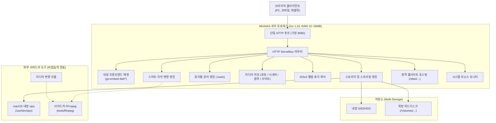

# MiniNAS 시스템 요구사항 및 기술 규격서 (SPEC.md)

> 문서 버전: v0.8  
> 최신 개정일: 2026-11-18  
> 최초 작성일: 2026-11-07  
> 목적: 2011 Mac mini 등 구형 인텔 맥 하드웨어를 활용한 초경량 독립형 홈 NAS 애플리케이션의 아키텍처 원칙, 기능별 요구사항, API 규격, 제약 조건을 정의합니다.

---

## 1. 하드웨어 목표 및 제약 조건 (Target Constraints)

| 항목 | 규격 및 제약 조건 |
| :--- | :--- |
| 대상 기기 | 2011 Mac mini (Intel Core i5 Sandy Bridge, x86_64) |
| 운영체제 | macOS High Sierra (10.13.6) 이상 |
| 운영 형태 | 모니터와 키보드가 없는 무인 헤드리스(Headless) 24시간 가동 |
| 가용 리소스 제한 | 상시 메모리(RAM) 점유율 30MB 미만, 유휴 시 CPU 점유율 1% 미만 |
| 런타임 제약 | Docker 미사용, 외부 런타임(Python, Node.js, Java 등) 설치 요구 금지 |
| 배포 단위 | 프론트엔드를 자체 내장한 단일 정적 바이너리(Single Binary, Pure Go, CGO_ENABLED=0) |

---

## 2. 핵심 아키텍처 원칙 (Core Architectural Principles)

1. 단일 포트 단일 바이너리 (Monolithic Single Binary)
   - 프론트엔드 빌드 산출물을 Go의 `//go:embed`로 백엔드 바이너리에 직접 번들링합니다.
   - 단 하나의 포트(기본 8080)에서 웹 UI, REST API, 스트리밍, 정적 사이트 호스팅을 모두 처리합니다.

2. 사이드카 분리 패턴 (Sidecar Separation Pattern)
   - 코어 바이너리는 순수 Go 7.5MB 단일 파일로 가볍게 유지합니다.
   - 무거운 미디어 트랜스코딩 엔진(FFmpeg)은 독립 실행 파일(`tools/ffmpeg`)로 분리하여 필요할 때만 비동기 자식 프로세스로 호출합니다.

3. 무결점 레거시 호환성 (macOS 10.13 Target)
   - macOS 12+ 전용 보안 심볼(`_SecTrustCopyCertificateChain` 등) 링크를 차단합니다.
   - `CGO_ENABLED=0`, `MACOSX_DEPLOYMENT_TARGET=10.13` 옵션으로 순수 정적 빌드합니다.

4. 제로 버퍼 스트리밍 I/O (Zero-Buffer Streaming)
   - 파일 업로드 및 다운로드 시 메모리에 전체 데이터를 적재하지 않고 디스크와 네트워크 소켓 간에 직접 스트리밍(`io.Copy`)합니다.
   - 다중 파일/폴더 다운로드는 메모리 임시 압축 파일 생성 없이 실시간 ZIP 스트림으로 전송합니다.

5. 무손실 원본 보존 원칙 (Lossless Original Preservation)
   - 동영상 스트리밍 시 화질을 강제로 낮추거나 재인코딩하지 않습니다.
   - 100% 원본 비트레이트와 해상도를 유지하며, 스마트 버퍼링과 FastStart 메타데이터 최적화로 끊김을 해결합니다.

---

## 3. 세부 기능 규격서 (Functional Specifications)

### 3.1 스토리지 및 파일 시스템 (Storage Engine)
- 멀티 저장소(Multi-Storage):
  - 설정 파일(`config.json`)에 정의된 다수의 저장소 경로를 독립된 논리 스토리지로 마운트합니다.
  - `$HOME` 환경 변수를 자동 확장합니다.
  - 각 스토리지별 전체 용량, 사용량, 가용 공간을 실시간으로 조회(`statfs`)합니다.
- 보안 샌드박스 (Directory Traversal Protection):
  - 모든 파일 API 요청 경로는 `filepath.Clean`과 절대 경로 검증을 거칩니다.
  - 저장소 루트를 벗어나는 상위 경로 탈출(`../`) 시도를 차단하고 `403 Forbidden`을 반환합니다.
- 파일 조작 API:
  - 디렉토리 생성(`POST /api/files/mkdir`), 이름 변경(`POST /api/files/rename`).
  - 파일 복사(`POST /api/files/copy`) 및 이동(`POST /api/files/move`): 동일 스토리지 내 원자적 이동 및 크로스 스토리지 복사/이동을 지원합니다.
  - 대용량 파일 스트리밍 업로드 (`POST /api/files/upload`). 다중 업로드 시 취소 기능 및 브라우저 이탈 방지 가드를 지원합니다.
  - 다중 파일 및 폴더 실시간 ZIP 압축 다운로드 (`GET /api/files/download-zip`).
- 휴지통 시스템 (Trash Engine, `.trash`):
  - 파일 삭제(`POST /api/files/delete`) 요청 시 즉시 영구 삭제하지 않고 저장소 루트의 `.trash/files` 디렉토리로 안전 이동합니다.
  - `.trash/meta.json` 파일에 원본 경로, 파일 크기, 디렉토리 여부, 삭제 일시 메타데이터를 원자적으로 기록합니다.
  - 휴지통 목록 조회(`GET /api/trash`), 원본 복원(`POST /api/trash/restore`), 선택 항목 영구 삭제(`POST /api/trash/delete`), 휴지통 비우기(`POST /api/trash/empty`)를 지원합니다.

---

### 3.2 웹 파일 탐색기 (Web Explorer)
- 역할의 명확한 분리:
  - 파일 탐색기는 순수 폴더 계층 구조 탐색과 파일 관리에 집중합니다.
  - 미디어 감상은 전용 허브(시네마, 포토, 음악, 사이트)에서 수행합니다.
- 격자 ↔ 목록 뷰 즉각 전환:
  - 그리드 뷰: 미디어는 원본 비율 썸네일, 일반 파일은 확장자 아이콘으로 구성한 통합 그리드. 모바일에서는 3열 아이콘 뷰와 2줄 파일명 정렬을 적용합니다.
  - 목록 뷰: 미니 썸네일, 파일 크기, 수정일시를 표시하는 테이블 뷰.
- 체크박스 및 선택 조작:
  - 전체 선택 체크박스는 전체 선택과 전체 취소를 상호 토글합니다.
  - 항목 중 일부만 선택된 경우 인디터미네이트 사각 마이너스 아이콘을 표시합니다.
  - 단축키(`Cmd/Ctrl + A`)로 전체 선택 및 취소를 지원합니다.
- 다중 선택 클립보드 및 이동 모달:
  - 단축키(`Cmd/Ctrl+C`, `Cmd/Ctrl+X`, `Cmd/Ctrl+V`, `ESC`)를 지원합니다.
  - 이동 모달(`MoveModal`)을 통해 트리 구조에서 대상 폴더를 선택하고 원클릭으로 이동합니다.
- 스마트 파일명 중간 축약:
  - 긴 파일명 처리 시 앞부분 제목과 확장자를 유지하고 중간 해시 문자열만 축약합니다.
  - 마우스 호버 시 전체 파일명을 툴팁으로 표시합니다.

---

### 3.3 무손실 동영상 스트리밍 & 스마트 버퍼링
- 100% 원본 화질 유지:
  - 동영상 해상도나 비트레이트를 강제로 낮추지 않고 원본 파일 그대로 스트리밍합니다.
- 안티 채터링(Anti-Chattering) 안전 버퍼 회복:
  - 네트워크 일시 지연으로 영상이 멈출 때 최소 4초 분량의 안전 버퍼를 확보할 때까지 대기한 후 자동으로 재생을 재개합니다.
- 실시간 스트리밍 버퍼 HUD:
  - 플레이어 하단에 실시간 확보된 안전 버퍼 초수 및 상태 배지를 표시합니다.
- 무손실 FastStart 메타데이터 웹 최적화:
  - 비디오와 오디오 데이터를 재인코딩하지 않고 MP4 인덱스 메타데이터(`moov atom`)를 파일 맨 앞으로 이동합니다.
  - 첫 프레임 재생 지연(TTFF)을 4~6배 단축(0.3초대)하고 즉각적인 탐색(Seek)을 보장합니다.

---

### 3.4 4대 미디어 & 공유 허브 (Media & Sharing Hubs)

#### 1. 시네마 허브 (Cinema Hub)
- 전용 폴더 기반 영화/드라마 통합 라이브러리 (`GET /api/cinema?dedicated=true`):
  - 시네마 전용 저장소(`movies`, `cinema`) 및 각 저장소 1단계 하위의 시네마 전용 폴더(`영화`, `드라마`, `시네마`, `애니`, `예능`, `방송`, `cinema`, `movies`, `dramas`, `series`, `vod`, `tv` 등)만 격리 스캔하여 일반 폴더 파일의 혼입을 방지합니다.
  - 회차 표기가 포함된 시리즈 영상을 단일 카드로 자동 그룹화합니다.
- 자막 자동 매칭 & 실시간 WebVTT 변환:
  - 영상 파일명과 일치하는 외부 자막(`.srt`, `.smi`, `.vtt`)을 자동 매칭합니다.
  - 텍스트 인코딩을 자동 판별하여 브라우저 표준 UTF-8 WebVTT로 실시간 변환 스트리밍합니다.
- 서버 영구 캐시 연동 비디오 썸네일 큐:
  - 최초 1회 캡처된 비디오 썸네일을 서버 `.mininas_cache/thumbs/`에 영구 저장하고 이후 요청에서는 정적 JPEG로 즉시 서빙합니다.

#### 2. 포토 & 모먼트 (Photos Hub)
- 전용 폴더 기반 앨범(폴더) 카드 보기 및 촬영일 타임라인 (`GET /api/photos?dedicated=true`):
  - 포토 전용 저장소(`photos`, `albums`) 및 각 저장소 1단계 하위의 포토 전용 폴더(`사진`, `앨범`, `포토`, `카메라`, `일상`, `가족`, `여행`, `추억`, `photos`, `albums`, `pictures`, `dcim`, `camera` 등)만 격리 스캔합니다.
  - 하위 폴더별 앨범 카드 보기(기본)와 연월별 촬영일 타임라인 보기 전환을 지원합니다.
- 메타데이터 기반 실제 촬영일 추출 및 인덱스 캐시 (`GET /api/media/meta`):
  - 1순위: JPEG/HEIC EXIF(`DateTimeOriginal`) 및 MP4/MOV(`mvhd` 박스 `Seek` 점프, QuickTime 생성 시각) 파싱.
  - 2순위: 아이폰 라이브 포토(`.mov`) 및 파생 이미지의 동일 폴더 짝꿍 사진(`IMG_XXXX`) 촬영일 상속 및 인접 항목 날짜 보정.
  - 3순위: 파일명·폴더 경로 날짜 패턴 추출 및 업로드 시 클라이언트 `lastModified` 시각 보존.
  - 추출된 메타데이터는 `.mininas_cache/media_index_v2.json`에 캐싱하고 파일 삭제 시 고아 캐시를 자동 청소합니다.
- EXIF 회전 보정 및 경량 썸네일 서빙 (`GET /api/photos/thumb`, `POST /api/photos/thumb`):
  - EXIF 내장 썸네일 추출 시 원본의 `Orientation`(`0x0112`) 회전 태그를 함께 주입하고, `sips` 리사이즈 캐시와 연동하여 원본 비율(`object-contain`)을 유지한 고속 썸네일을 서빙합니다.

#### 3. 음악 허브 (Music Hub)
- 전용 폴더 기반 오디오 통합 라이브러리 (`GET /api/music?dedicated=true`):
  - 음악 전용 저장소(`music`) 및 전용 폴더(`음악`, `노래`, `오디오`, `music`, `audio`, `songs`, `ost` 등) 내 오디오 파일(MP3, FLAC, M4A, AAC, WAV)을 자동 스캔하여 트랙 및 앨범별로 분류합니다.
- ID3v2 앨범 표지(Cover Art) 고속 추출 (`GET /api/music/cover`):
  - Go 표준 라이브러리 기반 파서로 MP3(ID3v2.2, v2.3, v2.4) APIC/PIC 프레임 및 FLAC 메타데이터 블록에서 JPEG/PNG 표지를 추출합니다.
  - 태그 부재 시 동일 폴더 내 커버 이미지(`cover.jpg`, `folder.jpg` 등)를 자동 탐색하여 대체 서빙합니다.
  - 인메모리 캐시 및 HTTP 브라우저 캐시(`max-age=86400`)를 적용합니다.
- 글로벌 백그라운드 오디오 플레이어:
  - 탭 이동 중에도 하단에서 음악이 끊김 없이 지속 재생됩니다.
  - 앨범 표지 렌더링, 셔플, 반복 재생, 스크러빙을 지원합니다.

#### 4. 웹 사이트 쇼케이스 (Sites Hub)
- 정적 웹사이트 자동 호스팅 (`GET /sites/...`, `GET /api/sites`):
  - 저장소 내 웹 프로젝트 폴더를 별도 웹서버 설치 없이 독립 URL로 즉시 서비스합니다.
  - `index.html`이 포함된 폴더를 자동 감지하여 와이드 카드 썸네일로 등록합니다.
  - `index.html`이 없는 일반 폴더 접근 시 디렉토리 인덱싱을 제공합니다.

---

### 3.5 모바일 UI/UX 및 미디어 뷰어 최적화
- 하단 반투명 캡슐 컨트롤러:
  - 모바일 미디어 뷰어에서 화면 좌우 플로팅 버튼을 숨기고 하단 중앙 캡슐로 이동하여 컨텐츠 가림을 해소합니다.
  - 고정폭 숫자 속성(`tabular-nums`)과 최소 너비를 적용하여 번호 변동 시 버튼 밀림을 차단합니다.
  - 키보드 단축키 안내 등 모바일 불필요 텍스트를 제거합니다.
- 사이드바 단일 플로우 레이아웃:
  - `justify-between`을 단일 수직 스크롤 플로우로 전환하여 모바일 화면에서 외형 섹션과 하단 시스템 푸터 간 겹침을 원천 해결했습니다.
  - 모바일 세이프 에어리어 패딩을 적용하여 하단 홈 바 가림을 방지합니다.

---

### 3.6 외형 설정 및 시스템 모니터링 일원화
- 좌측 사이드바 외형 및 스타일:
  - 테마 스타일 (macOS / Console / Studio) 3단계 원클릭 세그먼트 버튼 제공.
  - 컬러 톤 (다크 / 나이트 / 라이트) 3단계 원클릭 세그먼트 버튼 제공.
  - 텍스트 크기 (작게 / 보통 / 크게) 3단계 원클릭 세그먼트 버튼 제공.
- 좌측 사이드바 시스템 정보 푸터:
  - 호스트명, CPU 실시간 부하 게이지, 메모리 사용률 게이지, 가동 시간을 사이드바 푸터에서 상시 모니터링합니다.
- 상단 헤더 순수화:
  - 테마/폰트 드롭다운 및 시스템 칩을 헤더에서 제거하고 검색 및 파일 뷰/정렬 전용 액션 바로 정돈했습니다.

---

### 3.7 사이드카 미디어 변환기 (Sidecar Media Converter)
- 웹 호환성 자동 진단 (`GET /api/media/inspect`):
  - 비디오/오디오 코덱 분석 및 내장 자막 트랙 감지.
- 초고속 스트림 복사 & AAC 변환 (`POST /api/media/batch-convert`):
  - 비디오 스트림 무손실 복사, 비표준 오디오만 표준 AAC로 고속 변환.
  - FastStart 최적화 및 한국어 자막 스트림 자동 추출 지원.

---

### 3.8 아이폰 사진 및 썸네일 캐싱 (HEIC Processing)
- `sips` 기반 실시간 무손실 변환:
  - 아이폰 사진(`.heic`) 요청 시 macOS 내장 `/usr/bin/sips` 도구를 호출하여 JPEG로 즉시 변환 서빙합니다.
  - 변환 결과는 `~/.mininas_cache/thumbs/`에 캐싱하여 중복 변환을 방지합니다.

---

### 3.9 시스템 운영 및 데몬 관리 (DevOps & Daemon)
- macOS `launchd` 데몬화:
  - `com.mininas.server.plist`를 통한 부팅 시 자동 시작(RunAtLoad) 및 장애 시 자동 복구(KeepAlive) 지원.
- 사전 설정 진단 (Pre-flight Checker):
  - `mininas -config <file> -check` 플래그로 가동 전 설정 파일 문법 및 디렉토리 유효성 사전 검증.
- 원클릭 제어 스크립트:
  - `start-nas.command`: 데몬 등록 및 백그라운드 가동
  - `stop-nas.command`: 데몬 중지
  - `restart-nas.command`: 사전 진단 후 안전 재시작
  - `check-config.command`: 설정 파일 문법/경로 검사
  - `convert-folder.command`: 터미널 미디어 일괄 변환 도구

---

## 4. REST API 규격 요약

| Method | Endpoint | 설명 | 주요 파라미터 / 페이로드 |
| :--- | :--- | :--- | :--- |
| `GET` | `/api/storages` | 등록된 스토리지 목록 및 용량 조회 | - |
| `GET` | `/api/files` | 특정 디렉토리 파일 목록 조회 | `storage`, `path`, `recursive`, `type` |
| `POST` | `/api/files/upload` | 파일 스트리밍 업로드 | Multipart Form: `storage`, `targetPath`, `files` |
| `POST` | `/api/files/mkdir` | 새 디렉토리 생성 | `{"storage":"...","parentPath":"...","name":"..."}` |
| `POST` | `/api/files/rename` | 파일 또는 폴더 이름 변경 | `{"storage":"...","path":"...","newName":"..."}` |
| `POST` | `/api/files/delete` | 파일/폴더 삭제 (휴지통 이동 또는 영구 삭제) | `{"storage":"...","paths":["..."],"permanent":false}` |
| `POST` | `/api/files/copy` | 파일 복사 (크로스 스토리지 지원) | `{"sourceStorage":"...","targetStorage":"...","sourcePaths":["..."],"targetDir":"..."}` |
| `POST` | `/api/files/move` | 파일 이동 (크로스 스토리지 지원) | `{"sourceStorage":"...","targetStorage":"...","sourcePaths":["..."],"targetDir":"..."}` |
| `GET` | `/api/files/download` | 단일 파일 다운로드 | `storage`, `path` |
| `GET` | `/api/files/stream` | 미디어 HTTP 206 부분 스트리밍 | `storage`, `path` (Range 헤더 지원) |
| `GET` | `/api/files/download-zip` | 다중 파일/폴더 실시간 ZIP 다운로드 | `storage`, `path` (다중 반복 쿼리 파라미터) |
| `GET` | `/api/trash` | 특정 스토리지 휴지통 목록 조회 | `storage` |
| `POST` | `/api/trash/restore` | 휴지통 항목 원본 위치로 복원 | `{"storage":"...","ids":["..."]}` |
| `POST` | `/api/trash/delete` | 휴지통 선택 항목 영구 삭제 | `{"storage":"...","ids":["..."]}` |
| `POST` | `/api/trash/empty` | 특정 스토리지 휴지통 완전 비우기 | `{"storage":"..."}` |
| `GET` | `/api/photos` | 포토 전용 폴더 사진/동영상 앨범 및 타임라인 조회 | `dedicated`, `skip_special`, `type` (옵션) |
| `GET` | `/api/photos/thumb` | 사진/동영상 경량 캐시 썸네일 서빙 | `storage`, `path`, `v` |
| `POST` | `/api/photos/thumb` | 클라이언트 캡처 비디오 썸네일 서버 캐시 저장 | `{"storage":"...","path":"...","dataUrl":"..."}` |
| `GET` | `/api/media/meta` | 사진/동영상 EXIF 및 컨테이너 메타데이터 조회 | `storage`, `path` |
| `GET` | `/api/cinema` | 시네마 전용 폴더 영화/드라마 목록 조회 | `storage`, `dedicated` (옵션) |
| `GET` | `/api/music` | 음악 전용 폴더 오디오 라이브러리 조회 | `storage`, `dedicated` (옵션) |
| `GET` | `/api/music/cover` | 오디오 파일 ID3v2/폴더 앨범 표지 서빙 | `storage`, `path` |
| `GET` | `/api/sites` | 등록된 쇼케이스 웹사이트 목록 조회 | - |
| `POST` | `/api/sites/pin` | 특정 HTML 파일/폴더를 사이트 허브에 고정 | `{"storage":"...","path":"..."}` |
| `POST` | `/api/sites/unpin` | 사이트 허브에서 핀 고정 해제 | `{"storage":"...","path":"..."}` |
| `GET` | `/api/files/subtitles` | 영상 파일 대응 자막 목록 조회 | `storage`, `path` |
| `GET` | `/api/files/subtitle` | WebVTT 포맷 자막 실시간 스트리밍 | `storage`, `path`, `stream` |
| `GET` | `/api/media/capabilities` | 사이드카 FFmpeg 설치 여부 확인 | - |
| `GET` | `/api/media/inspect` | 영상 코덱 및 웹 호환성 정밀 분석 | `storage`, `path` |
| `POST` | `/api/media/batch-convert` | 무손실 FastStart 및 AAC 변환 작업 등록 | `BatchConvertRequest` JSON |
| `GET` | `/api/media/batch-convert/status` | 배치 변환 작업 진행률 폴링 | `jobId` |
| `GET` | `/api/system/stats` | CPU, RAM, 디스크, Uptime 실시간 모니터링 | - |
| `GET` | `/sites/*` | 정적 웹사이트 및 HTML 호스팅 | URL 경로 매핑 (`/sites/<storage>/<path>`) |

---

## 5. 무결성 검증 하네스 규격 (Verification Harness)

모든 코드 변경은 다음 4단계 하네스(`make test`)를 통과해야 배포할 수 있습니다:

### Stage 1: Frontend Build & TypeCheck
- TypeScript 정적 타입 검사(`tsc -b`)를 실행합니다.
- Vite 프로덕션 번들링을 실행하고 `dist/index.html` 생성 여부를 검증합니다.

### Stage 2: Backend Unit & Security Test
- 경로 탈출(`../`) 차단 보안 검증을 수행합니다.
- 스토리지 설정 파싱 및 사전 설정 진단(`validateConfig`) 검증을 수행합니다.
- 파일 조작(`mkdir`, `rename`, `copy`, `move`, `download`, `download-zip`, `stream`) 유닛 테스트를 수행합니다.
- 4대 미디어 허브(`/api/cinema`, `/api/photos`, `/api/music`, `/api/sites`) 및 ID3v2/폴더 앨범 표지 추출(`/api/music/cover`) 유닛 테스트를 수행합니다.
- 자막 파서(SRT, SMI, VTT, ASS) 및 UTF-8/EUC-KR 디코더 유닛 테스트를 수행합니다.
- 휴지통(`.trash`) 소프트 삭제, 메타데이터 기록, 복원, 선택 영구 삭제, 비우기 유닛 테스트를 수행합니다.

### Stage 3: macOS 10.13 Symbol Static Check
- 빌드된 Mach-O 바이너리(`mininas-intel-mac`)를 대상으로 `nm -u` 심볼 테이블을 전수 조사합니다.
- macOS 12+ 전용 최신 심볼(예: `_SecTrustCopyCertificateChain`) 포함 여부를 검증합니다. (허용 기준: 0건)

### Stage 4: 16개 실전 런타임 E2E 시나리오 검증
임시 격리 스토리지 환경에서 핵심 16개 시나리오를 자동 검증합니다:
1. CLI 사전 설정 진단 플래그 검증 (`mininas -config <file> -check`)
2. 테스트 서버 백그라운드 구동 검증
3. 멀티 저장소 목록 및 용량 조회 API 검증 (`/api/storages`)
4. 대용량 멀티파트 스트리밍 업로드 검증 (`/api/files/upload`)
5. 파일 목록 인덱싱 및 메타데이터 API 검증 (`/api/files`)
6. 디렉토리 생성, 복사, 이름 변경, 단일 파일 다운로드 검증 (`/api/files/mkdir`, `/copy`, `/rename`, `/download`)
7. 크로스 스토리지 파일 이동 검증 (`/api/files/move`)
8. HTTP 206 미디어 Range 스트리밍 검증 (`/api/files/stream`)
9. 실시간 ZIP 압축 스트리밍 검증 (`/api/files/download-zip`)
10. macOS 하드웨어 및 디스크 모니터링 API 검증 (`/api/system/stats`)
11. 정적 HTML 웹사이트 호스팅(`/sites/...`) 및 사이트 허브 목록(`/api/sites`) 검증
12. SRT / SMI 자막 자동 매칭 및 실시간 WebVTT 변환 스트리밍 검증 (`/api/files/subtitles`, `/api/files/subtitle`)
13. 시네마 허브(`/api/cinema`) 및 포토 허브(`/api/photos?skip_special=true`) 통합 수집 검증
14. 음악 허브 오디오 수집(`/api/music`) 및 앨범 표지 서빙(`/api/music/cover`) 검증
15. 휴지통 소프트 삭제, 목록 조회, 원본 복구, 선택 영구 삭제, 비우기 E2E 검증 (`/api/trash/*`)
16. 전용 폴더 격리(`?dedicated=true`), 미디어 메타데이터 추출(`/api/media/meta`), 경량 썸네일 캐시(`/api/photos/thumb`) 검증

