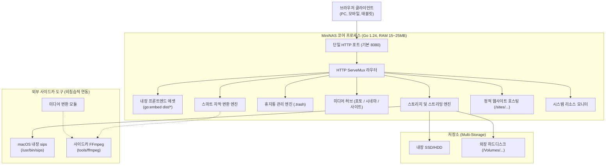

# MiniNAS 시스템 요구사항 및 기술 규격서 (SPEC.md)

> **문서 버전**: v0.5  
> **최신 개정일**: 2026-11-16  
> **최초 작성일**: 2026-11-07  
> **목적**: 2011 Mac mini 등 구형 인텔 맥 하드웨어를 활용한 초경량 독립형 홈 NAS 애플리케이션의 아키텍처 원칙, 기능별 요구사항, API 규격, 제약 조건을 정의합니다. 본 문서는 새로운 기능이 추가되거나 아키텍처가 변경될 때마다 지속적으로 갱신합니다.

---

## 1. 하드웨어 목표 및 제약 조건 (Target Constraints)

| 항목 | 규격 및 제약 조건 |
| :--- | :--- |
| **대상 기기** | 2011 Mac mini (Intel Core i5 Sandy Bridge, x86_64) |
| **운영체제** | macOS High Sierra (10.13.6) 이상 |
| **운영 형태** | 모니터와 키보드가 없는 무인 헤드리스(Headless) 24시간 가동 |
| **가용 리소스 제한** | 상시 메모리(RAM) 점유율 **30MB 미만**, 유휴 시 CPU 점유율 **1% 미만** |
| **런타임 제약** | **Docker 미사용**, 외부 런타임(Python, Node.js, Java, .NET 등) 설치 요구 금지 |
| **배포 단위** | 프론트엔드를 자체 내장한 단일 정적 바이너리(Single Binary, Pure Go, CGO_ENABLED=0) |

---

## 2. 핵심 아키텍처 원칙 (Core Architectural Principles)

1. **단일 포트 단일 바이너리 (Monolithic Single Binary)**
   - 프론트엔드(React + TypeScript + Tailwind) 빌드 산출물을 Go의 `//go:embed`로 백엔드 바이너리에 직접 번들링합니다.
   - 단 하나의 포트(기본 8080)에서 웹 UI, REST API, 스트리밍, 정적 사이트 호스팅을 모두 처리합니다.

2. **사이드카 분리 패턴 (Sidecar Separation Pattern)**
   - 코어 바이너리는 7MB 순수 Go로 가볍게 유지합니다.
   - 무거운 미디어 트랜스코딩 엔진(FFmpeg)은 코어에 내장하지 않습니다. 독립 실행 파일(`tools/ffmpeg`)로 분리하여 필요할 때만 비동기 자식 프로세스로 호출합니다.

3. **무결점 레거시 호환성 (macOS 10.13 Target)**
   - macOS 12+ 전용 보안 심볼(`_SecTrustCopyCertificateChain` 등) 링크를 차단합니다.
   - `CGO_ENABLED=0`, `MACOSX_DEPLOYMENT_TARGET=10.13` 옵션으로 순수 정적 빌드합니다.

4. **제로 버퍼 스트리밍 I/O (Zero-Buffer Streaming)**
   - 파일 업로드 및 다운로드 시 메모리에 전체 데이터를 적재하지 않습니다. 디스크와 네트워크 소켓 간에 직접 스트리밍(`io.Copy`)합니다.
   - 다중 파일/폴더 다운로드는 메모리 임시 압축 파일 생성 없이 `archive/zip` 실시간 스트림으로 전송합니다.

5. **무손실 원본 보존 원칙 (Lossless Original Preservation)**
   - 동영상 스트리밍 시 화질을 강제로 낮추거나 재인코딩하지 않습니다.
   - 100% 원본 비트레이트와 해상도를 유지하며, 스마트 버퍼링과 메타데이터 최적화로 끊김을 해결합니다.

---

## 3. 세부 기능 규격서 (Functional Specifications)

### 3.1 스토리지 및 파일 시스템 (Storage Engine)
- **멀티 저장소(Multi-Storage)**:
  - 설정 파일(`config.json`)에 정의된 다수의 저장소 경로(내장 경로, 외장 하드 `/Volumes/...`)를 독립된 논리 스토리지로 마운트합니다.
  - `$HOME` 환경 변수를 자동 확장합니다.
  - 각 스토리지별 전체 용량, 사용량, 가용 공간을 실시간으로 조회(`statfs` 시스템 콜)합니다.
- **보안 샌드박스 (Directory Traversal Protection)**:
  - 모든 파일 API 요청 경로는 `filepath.Clean`과 절대 경로 검증을 거칩니다.
  - 저장소 루트를 벗어나는 상위 경로 탈출(`../`) 시도를 원천 차단하고 `403 Forbidden`을 반환합니다.
- **파일 조작 API**:
  - 디렉토리 생성(`POST /api/files/new-folder`), 이름 변경(`POST /api/files/rename`).
  - 파일 복사(`POST /api/files/copy`) 및 이동(`POST /api/files/move`): 동일 스토리지 내 원자적 이동을 지원합니다. 다른 스토리지 간 복사 및 이동도 지원합니다. 파일명 중복 시 자동 고유명(`(1)`)을 부여합니다.
  - 대용량 파일 청크 스트리밍 업로드 (`multipart/form-data`).
  - 다중 파일 및 폴더 실시간 ZIP 압축 다운로드 (`GET /api/files/download-zip`).
- **휴지통 시스템 (Trash Engine, `.trash`)**:
  - 파일 삭제(`POST /api/files/delete`) 요청 시 즉시 영구 삭제하지 않고 저장소 루트의 `.trash/files` 디렉토리로 안전 이동합니다.
  - `.trash/meta.json` 파일에 원본 경로, 파일 크기, 디렉토리 여부, 삭제 일시 메타데이터를 원자적으로 기록합니다.
  - 휴지통 목록 조회(`GET /api/trash`), 원본 경로로 100% 완벽 복원(`POST /api/trash/restore`), 선택 파일 영구 삭제(`POST /api/trash/delete`), 휴지통 전체 비우기(`POST /api/trash/empty`)를 지원합니다.

---

### 3.2 웹 파일 탐색기 (Web Explorer)
- **역할의 명확한 분리 (Role Separation)**:
  - 파일 탐색기는 순수 폴더 계층 구조 탐색과 파일 관리에 집중합니다.
  - 미디어 감상은 전용 허브(포토, 시네마, 사이트)에서 수행합니다.
- **격자 ↔ 목록 뷰 즉각 전환**:
  - `[격자 보기]`: 미디어는 원본 비율 썸네일, 일반 파일은 확장자 아이콘으로 구성한 통합 그리드.
  - `[목록 보기]`: 미니 썸네일, 파일 크기, 수정일시를 표시하는 테이블 뷰.
  - 두 뷰 모드는 서로 간섭 없이 즉각 전환됩니다.
- **다중 선택 클립보드 및 이동 모달**:
  - 단축키(`Cmd/Ctrl+C`, `Cmd/Ctrl+X`, `Cmd/Ctrl+V`)를 지원합니다.
  - 복사 또는 잘라내기 시 상단에 상태 안내 배너를 고정 표시합니다.
  - `ESC` 키 입력 시 클립보드 작업을 즉시 취소합니다.
  - [폴더로 이동] 모달(`MoveModal`)을 통해 트리 구조에서 대상 폴더를 선택하고 원클릭으로 이동합니다.
- **스마트 파일명 중간 축약 (`truncateMiddle`)**:
  - 긴 릴리즈 파일명 처리 시 앞부분 제목, 회차 번호, 확장자를 유지하고 중간 해시 문자열만 `...`으로 축약합니다.
  - 마우스 호버 시 전체 파일명을 툴팁으로 표시합니다.
- **HTML5 History API 연동**:
  - 폴더 이동 시 URL 쿼리 파라미터(`?storage=...&path=...`)를 실시간으로 갱신합니다.
  - 브라우저 뒤로 가기 및 앞으로 가기 동작 시 NAS 내부에서 직전 폴더로 안전하게 이동합니다.

---

### 3.3 무손실 동영상 스트리밍 & 스마트 버퍼링 (Lossless Streaming & Smart Buffering)
- **100% 원본 화질 유지 (Lossless Video Streaming)**:
  - 동영상 해상도나 비트레이트를 강제로 낮추지 않고 원본 파일 그대로 스트리밍합니다.
- **안티 채터링(Anti-Chattering) 안전 버퍼 회복**:
  - 네트워크 일시 지연으로 영상이 멈출 때(`waiting`, `stalled`), 0.5초 만에 섣불리 재생을 재개하지 않습니다.
  - 최소 4초 분량의 안전 버퍼를 확보할 때까지 대기한 후 자동으로 부드럽게 재생을 재개합니다.
  - 버퍼 충전 중에는 반투명 HUD 오버레이를 통해 현재 확보 상태(`현재 X.Xs / 목표 4.0s`)를 표시합니다.
- **실시간 스트리밍 버퍼 HUD**:
  - 플레이어 하단에 실시간 확보된 안전 버퍼 초수(예: `34.2s 확보됨`) 및 상태 배지(쾌적 / 안전 / 부족)를 표시합니다.
  - 전체 영상 길이 대비 버퍼링 완료 구간 비율(%)을 타임라인에 시각화합니다.
- **적극적 선행 다운로드 (`preload="auto"`)**:
  - 브라우저가 유휴 상태에서 소극적으로 멈추지 않고 선행 버퍼를 30~60초 이상 지속 확보하도록 유도합니다.
- **무손실 FastStart 메타데이터 웹 최적화**:
  - 비디오와 오디오 데이터를 재인코딩하지 않습니다.
  - MP4 컨테이너의 인덱스 메타데이터(`moov atom`)를 파일 맨 앞으로 이동(`-c copy -movflags +faststart`)합니다.
  - 첫 프레임 재생 지연(TTFF)을 4~6배 단축(0.3~0.6초대)하고, 원거리 Seek 시 즉각 반응하도록 최적화합니다.

---

### 3.4 3대 미디어 & 공유 허브 (Media & Sharing Hubs)

#### 1. 포토 & 모먼트 (Photos Hub)
- **전 저장소 통합 타임라인 (`GET /api/photos`)**:
  - 모든 마운트된 저장소의 사진과 동영상을 날짜순(연월별 타임라인)으로 통합 수집합니다.
  - 수량 제한(기존 5,000개 한도)과 용량 제한(기존 150MB 한도)을 완전히 폐지하여 1만 장 이상의 사진과 4K 비디오도 누락 없이 표시합니다.
- **스마트 스킵 폴더 토글**:
  - `[시네마/웹 제외]` ↔ `[모든 폴더 포함]` 전환 버튼을 제공합니다.
  - 기본 모드에서는 `movies`, `dramas`, `sites` 폴더를 제외하여 순수 개인 일상 미디어만 정갈하게 표시합니다.
- **원본 종횡비 보존 썸네일 엔진**:
  - 강제 크롭이나 왜곡 없이 원본 비율(`object-contain`)을 보존하는 캔버스 캡처 썸네일을 제공합니다.
  - 세로 영상(9:16)과 클래식 4:3 비율 영상도 왜곡 없이 표시합니다.

#### 2. 시네마 허브 (Cinema Hub)
- **전 저장소 영화/드라마 통합 라이브러리 (`GET /api/cinema`)**:
  - 외장 HDD와 내장 저장소의 `movies`, `dramas` 디렉토리를 자동 스캔하여 OTT 스타일의 카드 그리드로 렌더링합니다.
- **스마트 자막 자동 매칭 & 실시간 WebVTT 변환**:
  - 영상 파일명과 일치하는 외부 자막(`.srt`, `.smi`, `.vtt`)을 자동 매칭합니다.
  - 텍스트 인코딩(UTF-8, EUC-KR, CP949)을 자동 판별하여 브라우저 표준 UTF-8 WebVTT로 실시간 변환 스트리밍합니다.
  - ASS 특수 스타일 태그(`{\an8}`, 중괄호 코드)를 표준 WebVTT 큐로 정제합니다.
  - 복수 자막 트랙(`[한국어 (외장)]`, `[한국어 (내장)]`, 다국어) 원클릭 전환 바를 제공합니다.

#### 3. 웹 사이트 쇼케이스 (Sites Hub)
- **정적 웹사이트 자동 호스팅 (`GET /sites/...`, `GET /api/sites`)**:
  - 저장소 내 웹 프로젝트 폴더를 별도 웹서버 설치 없이 독립 URL로 즉시 서비스합니다.
  - `index.html`이 포함된 폴더를 자동 감지하여 16:9 와이드 카드 썸네일로 쇼케이스에 등록합니다.
  - 일반 아카이브 HTML 파일도 우클릭 메뉴 `[사이트 허브에 고정]`으로 손쉽게 핀 등록할 수 있습니다.
  - `index.html`이 없는 일반 폴더 접근 시 탐색기 스타일의 디렉토리 인덱싱을 제공합니다.

---

### 3.5 사이드카 미디어 변환기 (Sidecar Media Converter)
- **웹 호환성 자동 진단 (`GET /api/media/inspect`)**:
  - 비디오 코덱(H.264, VP8, VP9, AV1 지원 여부).
  - 오디오 코덱(AAC, MP3, Opus 지원 여부 / EAC3, AC3, DTS 등 미지원 코덱 감지).
  - 내장 자막 트랙 목록 및 한국어 자막 포함 여부.
- **초고속 스트림 복사 & AAC 변환 (`POST /api/media/batch-convert`)**:
  - 비디오 스트림은 재인코딩 없이 무손실 고속 복사(`-c:v copy`)합니다.
  - 브라우저 미지원 오디오만 표준 AAC로 고속 변환(`-c:a aac -b:a 192k`)합니다.
  - 내장된 한국어 자막 스트림을 별도 `.ko.srt` 파일로 자동 추출합니다.
  - FastStart 최적화 옵션 선택 시 100% 무손실 헤더 이동을 함께 처리합니다.
  - 백그라운드 고루틴으로 실행하며 진행률 폴링 API(`GET /api/media/batch-convert/status`)를 제공합니다.

---

### 3.6 아이폰 사진 및 썸네일 캐싱 (HEIC Processing)
- **`sips` 기반 실시간 무손실 변환**:
  - 브라우저에서 직접 볼 수 없는 아이폰 사진(`.heic`) 요청 시 macOS 내장 `/usr/bin/sips` 도구를 호출하여 JPEG로 즉시 변환 서빙합니다.
  - 변환 결과는 `~/.mininas_cache/thumbs/`에 캐싱하여 중복 변환을 방지합니다.

---

### 3.7 시스템 운영 및 데몬 관리 (DevOps & Daemon)
- **macOS `launchd` 데몬화**:
  - `com.mininas.server.plist`를 통한 부팅 시 자동 시작(RunAtLoad) 및 장애 시 자동 복구(KeepAlive)를 지원합니다.
- **사전 설정 진단 (Pre-flight Checker)**:
  - `mininas -config <file> -check` 플래그로 가동 전 설정 파일 문법 및 디렉토리 유효성을 사전 검증합니다.
- **원클릭 제어 스크립트**:
  - `start-nas.command`: 데몬 등록 및 백그라운드 가동
  - `stop-nas.command`: 데몬 중지
  - `restart-nas.command`: 사전 진단 후 안전 재시작
  - `check-config.command`: 설정 파일 문법/경로 검사
  - `convert-folder.command`: 터미널 미디어 일괄 변환 도구

---

## 4. REST API 규격 요약

| Method | Endpoint | 설명 | 주요 파라미터 / 페이로드 |
| :--- | :--- | :--- | :--- |
| `GET` | `/api/storages` | 등록된 스토리지 목록 및 용량 조회 | - |
| `GET` | `/api/files` | 특정 디렉토리 파일 목록 조회 | `storage`, `path` |
| `POST` | `/api/files/upload` | 파일 스트리밍 업로드 | Multipart Form: `storage`, `targetPath`, `files` |
| `POST` | `/api/files/new-folder` | 새 디렉토리 생성 | `{"storage":"...","path":"...","name":"..."}` |
| `POST` | `/api/files/rename` | 파일 또는 폴더 이름 변경 | `{"storage":"...","oldPath":"...","newName":"..."}` |
| `POST` | `/api/files/delete` | 파일/폴더 삭제 (휴지통 이동) | `{"storage":"...","paths":["..."]}` |
| `POST` | `/api/files/copy` | 파일 복사 (크로스 스토리지 지원) | `{"sourceStorage":"...","sourcePath":"...","targetStorage":"...","targetPath":"..."}` |
| `POST` | `/api/files/move` | 파일 이동 (크로스 스토리지 지원) | `{"sourceStorage":"...","sourcePath":"...","targetStorage":"...","targetPath":"..."}` |
| `GET` | `/api/files/download` | 단일 파일 다운로드 | `storage`, `path` |
| `GET` | `/api/files/stream` | 미디어 HTTP 206 부분 스트리밍 | `storage`, `path` (Range 헤더 지원) |
| `GET` | `/api/files/download-zip` | 다중 파일/폴더 실시간 ZIP 다운로드 | `storage`, `paths` (쉼표 구분) |
| `GET` | `/api/trash` | 특정 스토리지 휴지통 목록 조회 | `storage` |
| `POST` | `/api/trash/restore` | 휴지통 항목 원본 위치로 복원 | `{"storage":"...","ids":["..."]}` |
| `POST` | `/api/trash/delete` | 휴지통 항목 영구 삭제 | `{"storage":"...","ids":["..."]}` |
| `POST` | `/api/trash/empty` | 특정 스토리지 휴지통 완전 비우기 | `{"storage":"..."}` |
| `GET` | `/api/photos` | 전 저장소 사진/동영상 타임라인 조회 | `skipFolders` (옵션) |
| `GET` | `/api/cinema` | 전 저장소 영화/드라마 목록 조회 | - |
| `GET` | `/api/sites` | 등록된 쇼케이스 웹사이트 목록 조회 | - |
| `POST` | `/api/sites/pin` | 특정 HTML 파일을 사이트 허브에 고정 | `{"storage":"...","path":"..."}` |
| `POST` | `/api/sites/unpin` | 사이트 허브에서 핀 고정 해제 | `{"storage":"...","path":"..."}` |
| `GET` | `/api/files/subtitles` | 영상 파일 대응 자막 목록 조회 | `storage`, `path` |
| `GET` | `/api/files/subtitle` | WebVTT 포맷 자막 실시간 스트리밍 | `storage`, `path`, `stream` (내장 트랙) |
| `GET` | `/api/media/capabilities` | 사이드카 FFmpeg 설치 여부 확인 | - |
| `GET` | `/api/media/inspect` | 영상 코덱 및 웹 호환성 정밀 분석 | `storage`, `path` |
| `POST` | `/api/media/batch-convert` | 무손실 FastStart 및 AAC 변환 작업 등록 | `BatchConvertRequest` JSON |
| `GET` | `/api/media/batch-convert/status` | 배치 변환 작업 진행률 폴링 | `jobId` |
| `GET` | `/api/system/stats` | CPU, RAM, 디스크, Uptime 실시간 모니터링 | - |
| `GET` | `/sites/*` | 정적 웹사이트 및 HTML 호스팅 | URL 경로 매핑 (`/sites/<storage>/<path>`) |

---

## 5. 무결성 검증 하네스 규격 (Verification Harness)

모든 코드 변경은 다음 4단계 하네스(`make test`)를 100% 통과해야 배포할 수 있습니다:

### Stage 1: Frontend Build & TypeCheck
- TypeScript 정적 타입 검사(`tsc -b`)를 실행합니다.
- Vite 프로덕션 번들링을 실행하고 `dist/index.html` 생성 여부를 검증합니다.

### Stage 2: Backend Unit & Security Test
- 경로 탈출(`../`) 차단 보안 검증을 수행합니다.
- 스토리지 설정 파싱 검증을 수행합니다.
- 자막 파서(SRT, SMI, VTT, ASS) 및 UTF-8 디코더 유닛 테스트를 수행합니다.
- 휴지통(`.trash`) 메타데이터 기록 및 복원 로직 유닛 테스트를 수행합니다.

### Stage 3: macOS 10.13 Symbol Static Check
- 빌드된 Mach-O 바이너리(`mininas-intel-mac`)를 대상으로 `nm -u` 심볼 테이블을 전수 조사합니다.
- macOS 12+ 전용 최신 심볼(예: `_SecTrustCopyCertificateChain`) 포함 여부를 검증합니다. (허용 기준: 0건)

### Stage 4: 12개 실전 런타임 E2E 시나리오 검증
격리된 임시 스토리지 환경에서 다음 12개 핵심 시나리오를 자동 검증합니다:
1. 테스트 서버 백그라운드 구동 검증
2. 멀티 저장소 목록 API 검증 (`/api/storages`)
3. 대용량 멀티파트 스트리밍 업로드 검증 (`/api/files/upload`)
4. 파일 목록 인덱싱 및 메타데이터 API 검증 (`/api/files`)
5. HTTP 206 미디어 Range 스트리밍 검증 (`/api/files/stream`)
6. 실시간 ZIP 압축 스트리밍 검증 (`/api/files/download-zip`)
7. macOS 하드웨어 및 디스크 모니터링 API 검증 (`/api/system/stats`)
8. 정적 HTML 웹사이트 호스팅(`/sites/...`) 실시간 서빙 검증
9. SRT / SMI 자막 자동 매칭 및 실시간 WebVTT 변환 스트리밍 검증
10. 시네마 허브 전 저장소 영화 통합 수집 및 자막 플래그 검증 (`/api/cinema`)
11. 포토 허브 전 저장소 사진/영상 타임라인 수집 검증 (`/api/photos`)
12. 휴지통(Trash) 소프트 삭제, 목록 조회 및 원본 복구 E2E 검증 (`/api/trash`, `/api/trash/restore`)

---

## 6. 향후 확장 로드맵 (Roadmap)

1. **인증 및 접근 제어 (Auth & Access Control)**:
   - 외부망 공개 시 비인가 접근 차단을 위한 세션 쿠키 기반 간이 PIN 또는 패스워드 인증을 추가합니다.
2. **외부 접속 및 원격 동기화 (Remote Access)**:
   - 포트포워딩 없는 **Tailscale** 또는 **Cloudflare Tunnel (`cloudflared`)** 통합 가이드를 제공합니다.
3. **모바일 백업 연동 (Mobile Backup)**:
   - 스마트폰 동기화 앱과 연동할 수 있는 경량 WebDAV 엔드포인트를 제공합니다.
