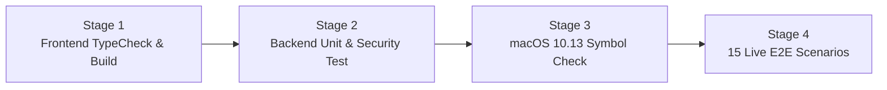

# MiniNAS 무결성 검증 하네스 설계 및 점검 보고서

> 기준 버전: v0.7  
> 작성일: 2026-11-17  
> 대상: `GEMINI.md`, `SPEC.md`, `harness/*.sh`, `backend/*_test.go`

---

## 1. 개요

MiniNAS는 2011 Mac mini(macOS 10.13 High Sierra, Intel x86_64) 환경에서 단일 바이너리로 동작합니다. 코드 변경 시 레거시 OS 호환성 깨짐, 경로 탈출 보안 취약점, 미디어 스트리밍 결함을 사전에 차단하기 위해 4단계 자동화 검증 하네스(`make test`)를 운영합니다.

본 문서는 v0.7 릴리즈 이후 수행한 하네스 전체 점검 결과와 규격 동기화 내역을 기록합니다.

---

## 2. 하네스 점검 결과 및 보완 내역

### 2.1 프로젝트 지침(`GEMINI.md`) 자체 정합성 보완

점검 과정에서 지침 문서가 스스로 정의한 규칙을 일부 위배하고 있던 문제를 발견하여 수정했습니다.

1. 개인 식별 정보(PII) 제거:
   - 금지 예시로 기재되어 있던 실제 로컬 호스트명 및 사용자 경로를 `<username>-macmini.local`, `/Users/<username>/...` 형태의 일반화된 패턴으로 교체했습니다.
2. 마크다운 서식 정리:
   - 문서 전반의 불필요한 볼드체 표기와 본문 내 장식용 이모지 예시 기호를 모두 제거했습니다.
   - 세 곳에 중복되어 있던 서식 및 이모지 제한 조항을 `2.6 Typography and Formatting Constraints`로 통합했습니다.
3. ASD-STE100 문장 규격 적용:
   - 25단어를 초과하던 도입부 문장을 단문으로 분리하고, 라틴어 약어(`e.g.`)를 `for example`로 통일했습니다.

---

### 2.2 `SPEC.md` 대비 테스트 커버리지 누락 해소

`SPEC.md` v0.7에 정의된 기능 및 REST API 중 기존 하네스에서 검증하지 않던 4개 영역을 추가했습니다.

| 구분 | 누락되었던 검증 항목 | 보완 내용 |
| :--- | :--- | :--- |
| 음악 허브 API | `GET /api/music`, `GET /api/music/cover` | 전 저장소 오디오 스캔, 아티스트/앨범 파싱, ID3v2.3 APIC JPEG 추출 및 폴더 `cover.jpg` 폴백 테스트 추가 |
| 기본 파일 조작 API | `POST /api/files/mkdir`, `rename`, `GET /api/files/download` | 디렉토리 생성, 파일 이름 변경, `Content-Disposition` 단일 파일 다운로드 검증 추가 |
| 휴지통 선택 삭제 | `POST /api/trash/delete` | 휴지통 내 특정 ID만 선택하여 영구 삭제하는 유닛 및 E2E 시나리오 추가 |
| 사전 설정 진단 | `mininas -config <file> -check` | E2E 런타임 하네스 1번 시나리오로 CLI 설정 검증 플래그 실행 추가 |

---

### 2.3 `SPEC.md`와 실제 구현 간 API 명세 동기화

백엔드 핸들러 구현과 `SPEC.md`의 REST API 요약 표 사이에 불일치하던 파라미터 명칭 5건을 실제 코드 기준으로 통일했습니다.

| Endpoint | 기존 `SPEC.md` 표기 | 실제 구현 및 수정된 표기 |
| :--- | :--- | :--- |
| `POST /api/files/mkdir` | `path` | `parentPath` |
| `POST /api/files/rename` | `oldPath` | `path` |
| `POST /api/files/copy`, `move` | `sourcePath`, `targetPath` | `sourcePaths` (배열), `targetDir` |
| `GET /api/files/download-zip` | `paths` (쉼표 구분) | `path` (반복 쿼리 파라미터) |
| `GET /api/photos` | `skipFolders` | `skip_special`, `type` |

---

### 2.4 하네스 셸 스크립트 구조 개선 (`harness/*.sh`)

1. 장식용 이모지 배제:
   - `run.sh`, `check_compatibility.sh`, `e2e_verify.sh` 출력의 장식용 이모지를 모두 제거하고 `[STAGE X/4]`, `[PASS]`, `[FAIL]`, `[WARN]` 텍스트 태그로 통일했습니다.
2. 심볼 정적 검사 정확도 향상:
   - `check_compatibility.sh`에서 `nm -u` 옵션을 사용하여 외부 미정의 심볼 테이블을 정확히 검사하도록 수정했습니다.
3. 테스트 아티팩트 자동 정리:
   - `run.sh`와 `e2e_verify.sh` 종료 시 검증용 임시 바이너리(`mininas-intel-mac`, `backend/mininas-e2e-test`)와 임시 디렉토리를 모두 삭제하여 작업 트리를 깨끗하게 유지합니다.

---

## 3. 4단계 검증 하네스 아키텍처 (`make test`)

### Stage 1: Frontend Build and TypeScript Static Check
- 실행 명령: `cd frontend && npm run build` (`tsc -b && vite build`)
- 검증 항목: TypeScript 타입 무결성 및 `backend/dist/index.html` 프로덕션 에셋 번들 생성 여부

### Stage 2: Backend Unit and Security Integration Tests
- 실행 명령: `cd backend && go test -v ./...`
- 유닛 테스트 스위트 구성 (총 19개 테스트 함수):
  - `main_test.go`:
    - `TestStorageSecurityTraversal`: 상위 경로 탈출(`../../etc/passwd`) 차단 검증
    - `TestGetStoragesAPI`: 멀티 저장소 마운트 및 디스크 통계 응답 검증
    - `TestFileUploadAndGetFiles`: 멀티파트 업로드, 목록 조회, 재귀 미디어 탐색(`recursive=true`) 검증
    - `TestRangeStreaming`: HTTP 206 Partial Content 바이트 범위 스트리밍 검증
    - `TestZipStreaming`: 다중 파일 실시간 ZIP 아카이브 스트리밍 검증
    - `TestFileCopyAndMove`: 동일 저장소 복사/이동, 중복 파일명 번호 부여(`(1)`), 크로스 스토리지 이동 검증
    - `TestStaticSiteHosting`: `/sites/` 정적 웹 호스팅, 디렉토리 인덱싱, 경로 탈출(`403`) 차단 검증
    - `TestConfigValidation`: `config.json` 문법 오류, 포트 범위 오류, 미존재 경로 경고 검증
    - `TestListSitesAPI`: 사이트 자동 감지 및 핀 고정(`/api/sites/pin`, `unpin`) 검증
    - `TestCinemaListAPI`: 시네마 허브 영상 스캔, 1MB 미만 클립 필터링, 자막 존재 플래그 검증
    - `TestPhotosListAPI`: 포토 허브 타임라인, `skip_special=true` 필터, `type=image|video` 필터 검증
    - `TestMkdirRenameAndDownload`: 폴더 생성, 이름 변경, 단일 파일 다운로드 검증
    - `TestMusicAndCoverAPI`: 음악 허브 스캔, ID3v2.3 APIC 커버 추출, 폴더 `cover.jpg` 폴백 검증
  - `subtitles_test.go`:
    - `TestConvertSRTToVTT`, `TestConvertSMIToVTT`: SRT/SMI 타임스탬프 및 위치 태그(`{\an8}`) WebVTT 변환 검증
    - `TestDecodeToUTF8`: UTF-8, UTF-8 BOM, EUC-KR 한글 자막 자동 디코딩 검증
    - `TestFindMatchingSubtitles`: 영상 파일 대응 다국어 자막 탐색 및 한국어 우선 정렬 검증
  - `trash_test.go`:
    - `TestTrashLifecycle`: 소프트 삭제, `.trash` 폴더 은닉 및 접근 차단(`403`), 복원, 선택 영구 삭제, 비우기 검증
    - `TestPermanentDelete`: `permanent: true` 즉시 영구 삭제 검증
  - `media_converter_test.go`:
    - `TestMediaCapabilitiesAPI`: 사이드카 FFmpeg 가용성 진단 API 검증

### Stage 3: macOS 10.13 Legacy Compatibility and Symbol Check
- 실행 스크립트: `harness/check_compatibility.sh`
- 검증 항목:
  1. `file` 명령을 통한 Mach-O 64-bit Intel `x86_64` 아키텍처 확인
  2. `nm -u` 명령을 통한 macOS 12+ 전용 심볼(`_SecTrustCopyCertificateChain`) 미포함(0건) 확인
  3. 단일 임베디드 바이너리 크기 예산(15MB 이하, 현재 약 8MB) 확인

### Stage 4: Live Runtime E2E Scenario Verification
- 실행 스크립트: `harness/e2e_verify.sh`
- 임시 격리 스토리지(`/tmp/mininas_e2e_XXXXXX`)와 포트 `8999`에서 실제 서버 프로세스를 띄우고 `curl`로 15개 런타임 시나리오를 순차 검증합니다:
  1. CLI 사전 설정 진단 플래그(`-config ... -check`) 실행
  2. 백그라운드 데몬 기동 및 프로세스 생존 확인
  3. 멀티 저장소 목록 및 용량 조회 (`GET /api/storages`)
  4. 멀티파트 파일 스트리밍 업로드 (`POST /api/files/upload`)
  5. 디렉토리 목록 및 메타데이터 인덱싱 (`GET /api/files`)
  6. 폴더 생성, 파일 복사, 이름 변경, 단일 파일 다운로드 (`/api/files/mkdir`, `copy`, `rename`, `download`)
  7. 크로스 스토리지 파일 이동 (`POST /api/files/move`)
  8. HTTP 206 Range 미디어 부분 스트리밍 (`GET /api/files/stream`)
  9. 실시간 ZIP 압축 스트리밍 다운로드 (`GET /api/files/download-zip`)
  10. 시스템 하드웨어 및 디스크 상태 조회 (`GET /api/system/stats`)
  11. 정적 웹사이트 호스팅(`/sites/...`) 및 사이트 허브 목록(`GET /api/sites`)
  12. SRT/SMI 자막 자동 탐색 및 실시간 WebVTT 변환 (`GET /api/files/subtitles`, `/api/files/subtitle`)
  13. 시네마 허브(`GET /api/cinema`) 및 포토 허브(`GET /api/photos?skip_special=true`) 통합 수집
  14. 음악 허브(`GET /api/music`) 및 앨범 표지 서빙(`GET /api/music/cover`)
  15. 휴지통 소프트 삭제, 목록 조회, 원본 복원, 선택 영구 삭제, 비우기 전 주기 (`/api/trash/*`)
